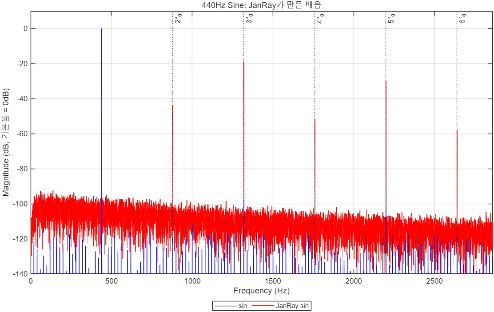

# 🎸 Guitar Effector Simulation

**입력 신호 · 시스템 · 출력 신호** 쌍으로 이펙터의 전달함수를 추정하고, 그 전달함수가 다른 신호에서도 같은 소리를 만들어내는지 확인하는 DSP 프로젝트입니다.
MATLAB과 Python을 함께 사용합니다.

---

## 📖 실험 흐름

### 1단계 — JanRay(오버드라이브)의 전달함수 추정

4가지 원신호를 JanRay 페달에 통과시키고, 원신호와 통과 신호로 전달함수 H(f)를 각각 추정했습니다.

| 원신호 (`DATA/source/`) | JanRay 통과 신호 (`DATA/janray/`) |
|---|---|
| `clean1.wav` (기타) | `janray.wav` |
| `gaussian_noise.wav` | `f(gaussian_noise).wav` |
| `impulse_response.wav` | `f(impulse_response).wav` |
| `sine_440Hz.wav` | `f(sine_440Hz).wav` |

추정한 4개의 H(f)를 처음 보는 기타 신호 `clean2.wav`에 적용했습니다 → `OUTPUT/janray/`

### 2단계 — 결과: JanRay는 LTI 시스템이 아니다

어떤 전달함수를 써도 JanRay를 통과한 소리처럼 바뀌지 않았습니다.
전달함수는 **선형·시불변(LTI)** 시스템만 완전히 표현할 수 있는데, 오버드라이브는 신호를 찌그러뜨리는(클리핑) **비선형** 시스템이기 때문입니다.

**근거 — 사인파 하나가 배음을 만든다 (`sin_janray.m`)**

LTI 시스템은 입력에 있는 주파수의 크기와 위상만 바꿀 수 있고, 입력에 없는 주파수를 새로 만들 수 없습니다.
그런데 440Hz 사인파 하나를 JanRay에 넣으면 출력에 440Hz의 정수배 주파수(배음)가 새로 생깁니다.



| 주파수 | 원신호 | JanRay 통과 |
|---|---|---|
| 440Hz (기본음 f₀) | 0 dB | 0 dB |
| 880Hz (2f₀) | -120 dB | -44 dB |
| 1320Hz (3f₀) | -98 dB | **-19 dB** |
| 1760Hz (4f₀) | -128 dB | -52 dB |
| 2200Hz (5f₀) | -103 dB | **-30 dB** |
| 2640Hz (6f₀) | -119 dB | -58 dB |

<sub>기본음 크기를 0dB로 맞춘 상대값. 원신호의 값은 사실상 잡음 수준입니다.</sub>

- 원신호에 사실상 없던 배음이 최대 약 80dB 커졌습니다.
- 홀수 배음(3f₀, 5f₀)이 짝수 배음보다 훨씬 큽니다. 대칭에 가까운 클리핑에서 나타나는 특징으로, 오버드라이브가 파형을 위아래로 눌러 자르고 있다는 뜻입니다.
- 전달함수 H(f)는 같은 주파수의 입력과 출력의 비율일 뿐이라서, 이렇게 새로 생긴 주파수 성분은 표현할 수 없습니다. 그래서 1단계의 결과가 실패한 것입니다.

`sin_janray.m`을 실행하면 두 신호의 dB 스펙트럼(배음 위치 점선 표시)과 시간 영역 파형을 그립니다.

**참고 — `JanRayAnalysis.m`**: clean1과 janray의 주파수 스펙트럼 비교

### 3단계 — LTI 시스템인 Delay로 같은 실험

비교를 위해 LTI 시스템인 Delay를 Python으로 직접 만들고(`delay.py`), 1단계와 같은 과정을 반복했습니다.

| 원신호 (`DATA/source/`) | Delay 통과 신호 (`DATA/delay/`) |
|---|---|
| `clean1.wav` | `c_delay.wav` |
| `gaussian_noise.wav` | `g_delay.wav` |
| `impulse_response.wav` | `i_delay.wav` |
| `sine_440Hz.wav` | `s_delay.wav` |
| `sine_sweep.wav` | `ss_delay.wav` |

각 쌍에서 추정한 H(f)를 `clean2.wav`에 적용했습니다 → `OUTPUT/delay/`

### 4단계 — 유사도 정량 분석

정답인 `DATA/delay/c2_delay.wav`(clean2에 Delay를 실제로 적용한 신호)와 각 전달함수의 결과를 비교해, 어떤 입력 신호로 추정한 전달함수가 가장 정확한지 점수를 매겼습니다 → `OUTPUT/wav_similarity_ranking.csv`

---

## 🗂️ 프로젝트 구조

```
Audio DSP/
├── DATA/
│   ├── source/                  # 원신호
│   │   ├── clean1.wav           # 기타 (전달함수 추정용)
│   │   ├── clean2.wav           # 기타 (전달함수 적용 테스트용)
│   │   ├── sine_440Hz.wav       # 440Hz 사인파
│   │   ├── impulse_response.wav # 임펄스
│   │   ├── gaussian_noise.wav   # 가우시안 노이즈
│   │   └── sine_sweep.wav       # 사인 스윕 (20Hz~20kHz, Delay 실험에만 사용)
│   ├── janray/                  # 원신호 → JanRay 통과 신호
│   └── delay/                   # 원신호 → Delay 통과 신호 (+ 정답 c2_delay.wav)
│
├── OUTPUT/
│   ├── janray/                  # JanRay 전달함수를 clean2에 적용한 결과
│   ├── delay/                   # Delay 전달함수를 clean2에 적용한 결과
│   └── wav_similarity_ranking.csv
│
├── osc.py                       # 원신호 생성 (사인파, 임펄스, 노이즈, 스윕)
├── delay.py                     # LTI Delay 이펙터
├── test_delay.py                # delay.py 테스트
│
├── main.m                       # 전달함수 추정 → clean2에 적용 (1·3단계)
├── estimate_transfer_function.m # 전달함수 추정 함수
├── apply_transfer_function.m    # 전달함수 적용 함수
├── sin_janray.m                 # 사인파 배음 dB 스펙트럼 → JanRay의 비선형성 (2단계)
├── JanRayAnalysis.m             # clean1 vs janray 스펙트럼 비교 (2단계)
├── time_domain_compare.m        # Delay 전후 파형 비교 (3단계)
└── compare_similarity.m         # 유사도 정량 분석 (4단계)
```

---

## ⚙️ 요구 환경

- **MATLAB** R2020a 이상, Signal Processing Toolbox
- **Python** 3.8 이상, `numpy`, `scipy` (테스트는 `pytest`)

```bash
pip install numpy scipy pytest
```

모든 스크립트는 **프로젝트 최상위 폴더에서** 실행합니다 (`DATA/...` 상대경로 사용).

---

## 🚀 실행 방법

### 1. 원신호 생성 (Python)

```bash
python osc.py
```

생성된 WAV 파일을 `DATA/source/` 폴더에 넣습니다.

### 2. Delay 적용 (Python)

```bash
python delay.py
```

`DATA/source/`의 입력 파일에 딜레이를 적용해 `DATA/delay/`에 저장합니다. 입력/출력 파일 목록과 파라미터는 `delay.py` 안에서 직접 수정합니다.

| 파라미터 | 기본값 | 설명 |
|---|---|---|
| `bpm` | 90.0 | 템포 (BPM) |
| `note` | `"eighth"` | 딜레이 음표 단위 |
| `mix` | 0.32 | 딜레이 믹스 비율 |
| `feedback` | 0.45 | 피드백 게인 |
| `repeats` | 7 | 반복 횟수 |

지원 note 종류: `whole`, `half`, `quarter`, `eighth`, `sixteenth`, `dotted_eighth`, `triplet_eighth`

### 3. 전달함수 추정 및 적용 (MATLAB)

`main.m`에서 `num` 값을 정하고 실행합니다.

| num | 시스템 | 입력 → 출력 | 결과 |
|---|---|---|---|
| 1 | JanRay | sine_440Hz → f(sine_440Hz) | `OUTPUT/janray/s_estimated_output.wav` |
| 2 | JanRay | impulse_response → f(impulse_response) | `OUTPUT/janray/i_estimated_output.wav` |
| 3 | JanRay | gaussian_noise → f(gaussian_noise) | `OUTPUT/janray/g_estimated_output.wav` |
| 4 | JanRay | clean1 → janray | `OUTPUT/janray/c_estimated_output.wav` |
| 5 | Delay | sine_440Hz → s_delay | `OUTPUT/delay/s_delay_output.wav` |
| 6 | Delay | impulse_response → i_delay | `OUTPUT/delay/i_delay_output.wav` |
| 7 | Delay | gaussian_noise → g_delay | `OUTPUT/delay/g_delay_output.wav` |
| 8 | Delay | clean1 → c_delay | `OUTPUT/delay/c_delay_output.wav` |
| 9 | Delay | sine_sweep → ss_delay | `OUTPUT/delay/ss_delay_output.wav` |

### 4. 유사도 평가 (MATLAB)

`compare_similarity.m`을 실행합니다. 기준(`refFile`)은 `DATA/delay/c2_delay.wav`, 비교 대상은 `OUTPUT/delay/`의 결과들입니다.

| 지표 | 설명 |
|---|---|
| Correlation | 시간 영역 상관계수 |
| NCC | 정규화 교차상관 |
| RMSE | 시간 영역 평균 제곱근 오차 |
| SpectralCosine | 주파수 영역 코사인 유사도 |
| LogSpectralRMSE | 로그 스펙트럼 RMSE (dB) |
| **SimilarityScore** | 통합 유사도 점수 (높을수록 유사) |

```
Score = 0.35 × Correlation + 0.35 × SpectralCosine
      + 0.15 × (1/(1+RMSE)) + 0.15 × (1/(1+LogSpectralRMSE))
```

---

## 🔬 핵심 알고리즘

### 전달함수 추정 (`estimate_transfer_function.m`)

1. xcorr로 시간 지연 보정
2. Hann 윈도우 적용 후 FFT
3. `H(f) = Y(f) / X(f)` (Tikhonov 정규화 포함)
4. Magnitude smoothing (이동 평균)
5. 최대 게인 제한 (8배)

### 전달함수 적용 (`apply_transfer_function.m`)

1. 입력 신호 FFT
2. H(f) 보간 후 주파수 영역 곱셈
3. IFFT로 시간 영역 복원
4. Peak normalization (0.95)

### Delay 이펙터 (`delay.py`)

BPM 기반 LTI 딜레이:

```
y[n] = dry_gain × x[n] + Σ (mix × feedback^(k-1)) × x[n - k×D]
```

- `D`: BPM과 음표로 계산된 딜레이 샘플 수
- `k`: 1 ~ repeats

---

## 📁 파일 이름 규칙

| 접두사 | 원신호 |
|---|---|
| `c_` | clean1 (기타) |
| `c2_` | clean2 (기타, 정답 비교용) |
| `s_` | sine_440Hz |
| `i_` | impulse_response |
| `g_` | gaussian_noise |
| `ss_` | sine_sweep |

| 형식 | 의미 |
|---|---|
| `f(xxx)` | xxx를 JanRay에 통과시킨 신호 |
| `*_delay` | Delay에 통과시킨 신호 |
| `*_estimated_output`, `*_delay_output` | 추정한 전달함수를 clean2에 적용한 결과 |
