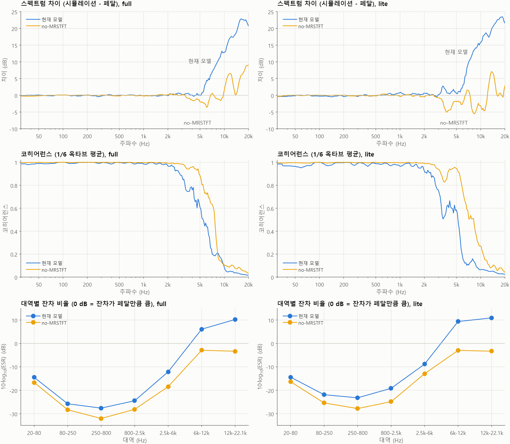

# 5단계 — NAM으로 JanRay 모델링

2단계에서 JanRay가 선형 시스템이 아니라는 것을 확인했다. 그래서 비선형까지 학습하는 신경망 모델 [NAM(Neural Amp Modeler)](https://github.com/sdatkinson/neural-amp-modeler)으로 페달을 다시 모델링했다.
최종 목표는 Raspberry Pi 4에서 실시간으로 돌리고 실제 페달과 비교하는 것이다.

**결론:** 학습에 쓰지 않은 기타 신호(`clean1.wav`)에서 NAM의 ESR은 0.002–0.010이다. 1단계 방식으로 다른 신호에서 추정한 전달함수는 0.84–1.0이었다.
NAM 기본 설정은 고음을 페달보다 크게 만들었는데, 원인은 MRSTFT 손실이었다. 이 손실을 끄고 다시 학습하니 ESR이 절반 아래로 줄었다. 다만 청음으로는 아직 확인하지 않았다.

## 폴더 구성

| 경로 | 설명 |
|---|---|
| `train_nam.py` | 학습한 뒤 `.nam` 파일로 내보내기 |
| `samplerate.py` | 학습용 wav의 샘플레이트, 채널, 길이 확인 |
| `models/janray.nam` | 기본 설정으로 학습한 모델 |
| `models/janray_nomrstft.nam` | MRSTFT 손실만 끄고 다시 학습한 모델 |
| `eval/simulate.py` | wav를 모델에 통과시키고 페달 녹음과 비교 |
| `eval/compare_clean1.m` | MATLAB 정밀 비교 (`compare_clean1.png`, `compare_nomrstft.png` 생성) |
| `eval/clean1_nam*.wav`, `eval/clean1_nomrstft*.wav` | 모델별 렌더링 결과 |
| `eval/listen/` | 시작 위치와 음량을 맞춘 청음 파일 5개 |

평가에 쓰는 `clean1.wav`와 실제 페달 녹음 `janray.wav`는 1단계와 같은 파일이다 (`../DATA/source/`, `../DATA/janray/`).

## 학습 데이터 (포함하지 않음)

학습에는 NAM v3 표준 입력 신호와 그 신호를 페달에 통과시킨 녹음을 썼다. 두 파일은 각각 약 27 MB라 이 저장소에 넣지 않았다.
다시 학습하려면 `nam/capture/`에 아래 두 파일을 넣는다 (`.gitignore`로 제외되어 있음).

| 파일 | 설명 |
|---|---|
| `capture/input.wav` | NAM v3 표준 입력 신호 (48 kHz) |
| `capture/output_fixed.wav` | 페달 출력 녹음 (44.1→48 kHz로 리샘플, 레이턴시 정렬, 24-bit 모노) |

> 이 캡처에는 속도 오차가 남아 있다. 44.1 kHz 소스를 48 kHz Logic 프로젝트에서 리앰프해서 페달은 입력을 약 8.8% 빠르게 들었다.
> `output_fixed.wav`는 길이만 되돌린 것이라 모델의 필터 주파수가 실제보다 약 8% 낮을 수 있고, ESR로는 이 오차를 알 수 없다.
> 없애려면 리샘플이 필요 없는 48 kHz 프로젝트에서 다시 캡처해야 한다.

> 헤더에 적힌 샘플레이트만으로는 실제 녹음 속도를 알 수 없다. 길이(frames)를 같이 비교할 것.

## 환경

- Windows 11, Python 3.13, NVIDIA RTX 2070 SUPER
- neural-amp-modeler 0.13.0
- MATLAB R2025b, Signal Processing Toolbox (비교 스크립트)

가상환경은 저장소 최상위에 만든다 (`.gitignore`로 제외됨).

```bash
python -m venv .venv
```

PyTorch(GPU 버전)를 **먼저** 설치한다. NAM을 먼저 설치하면 CPU 버전 PyTorch가 같이 깔린다.

```bash
.venv\Scripts\python.exe -m pip install torch --index-url https://download.pytorch.org/whl/cu128
.venv\Scripts\python.exe -m pip install neural-amp-modeler soundfile
```

GPU 인식 확인 (`True`가 나와야 함):

```bash
.venv\Scripts\python.exe -c "import torch; print(torch.__version__, torch.cuda.is_available())"
```

`Activate.ps1`에서 실행 정책 오류가 나면 `Set-ExecutionPolicy -Scope Process -ExecutionPolicy Bypass`를 쓰거나, 활성화하지 않고 `.venv\Scripts\python.exe`로 직접 실행한다.

## 학습

`train_nam.py`와 `samplerate.py`는 `capture/` 상대경로를 쓰므로 `nam` 폴더에서 실행한다.

```bash
cd nam
..\.venv\Scripts\python.exe samplerate.py
..\.venv\Scripts\python.exe train_nam.py
```

- 결과물은 `models/janray.nam`이다. 100 epoch에서 검증 ESR은 약 0.0066이었다.
- 학습이 끝나고 그래프 창이 뜨면 창을 닫아야 저장 단계로 넘어간다.
- `if __name__ == "__main__":`은 Windows에서 꼭 있어야 한다. PyTorch가 데이터를 불러올 때 띄우는 새 프로세스가 스크립트를 다시 import하는데, 이 조건문이 없으면 그때마다 학습이 다시 시작된다.
- 0.13.0의 `core.train()`에는 `architecture` 인자가 없다(내장 모델 설정을 고정으로 사용).

### 모델 구조

- 내보낸 `.nam`은 A2 `SlimmableContainer`이고 WaveNet 두 개가 들어 있다. full은 8채널(12,145 파라미터), lite는 3채널(1,870 파라미터)이다.
- lite가 이미 들어 있으므로 Pi 4용 모델을 `nam-full`로 따로 학습할 필요는 없을 수 있다.
- `nam.models._from_nam.init_from_nam`은 컨테이너를 바로 읽지 못한다. `config.submodels[i].model`을 넘겨야 한다.
- 모델 출력은 `output_fixed.wav`보다 33샘플 늦다. 널 테스트나 A/B 정렬에서 고려할 것.

### MRSTFT를 끄고 학습하기

NAM 기본 설정의 `mrstft_weight`(0.0005)만 끄려면 `core.train()`을 부르기 전에 설정 함수를 감싼다.
`janray_nomrstft.nam`은 `train_nam.py`와 같은 데이터, 같은 시드, 100 epoch에 아래 패치만 더해서 학습했다.

```python
from nam.train import core

_orig = core._get_packed_model_config

def patched():
    cfg = _orig()
    loss = cfg.get("loss", {})
    for k in list(loss):
        if "mrstft" in k:
            loss[k] = None
    return cfg

core._get_packed_model_config = patched
```

## 실제 페달과 비교

같은 클린 DI(`DATA/source/clean1.wav`)를 모델에 통과시켜 실제 페달 녹음(`DATA/janray/janray.wav`, 2026년 3월)과 비교한다. clean1은 학습에 쓰지 않았다.

### 렌더링 (저장소 최상위에서)

```bash
.venv\Scripts\python.exe nam/eval/simulate.py DATA/source/clean1.wav --gain -18 --match --ref DATA/janray/janray.wav
.venv\Scripts\python.exe nam/eval/simulate.py DATA/source/clean1.wav --gain -18 --match --ref DATA/janray/janray.wav --size lite
.venv\Scripts\python.exe nam/eval/simulate.py DATA/source/clean1.wav --model nam/models/janray_nomrstft.nam --size full --gain -18 --match --ref DATA/janray/janray.wav --out nam/eval/clean1_nomrstft.wav
.venv\Scripts\python.exe nam/eval/simulate.py DATA/source/clean1.wav --model nam/models/janray_nomrstft.nam --size lite --gain -18 --match --ref DATA/janray/janray.wav --out nam/eval/clean1_nomrstft_lite.wav
```

clean1은 입력 게인 -18 dB에서 페달과 가장 잘 맞는다. 0 dB로 넣으면 ESR이 0.11까지 나빠진다.

### MATLAB 비교

MATLAB에서 `nam/eval/compare_clean1.m`을 실행한다. 데이터 경로는 파일 위치 기준이라 MATLAB의 현재 폴더와 상관없다. PowerShell에서 저장소 최상위 폴더 기준으로 실행하려면:

```powershell
& "D:\Program Files\MATLAB\R2025b\bin\matlab.exe" -sd "$PWD" -batch "run(fullfile('nam','eval','compare_clean1.m'))"
```

소수 샘플까지 지연을 맞추고 최소제곱 게인 하나로 레벨을 맞춘 결과다.

| 항목 | 현재 full | no-MRSTFT full | 현재 lite | no-MRSTFT lite |
|---|---:|---:|---:|---:|
| ESR | 0.00407 | **0.00199** | 0.01005 | **0.00361** |
| ESR (프리엠퍼시스) | 0.01438 | **0.00323** | 0.02851 | **0.00690** |
| 널 깊이 | 23.91 dB | **27.01 dB** | 19.98 dB | **24.43 dB** |
| 6–12 kHz 에너지 차이 | +7.15 dB | **-0.54 dB** | +9.29 dB | **-0.30 dB** |
| 12 kHz 이상 에너지 차이 | +10.64 dB | **+1.57 dB** | +11.02 dB | **+1.49 dB** |
| 10 kHz 곡선 차이 | +12.84 dB | **+1.55 dB** | +15.83 dB | **-3.28 dB** |
| 20 kHz 곡선 차이 | +20.71 dB | **+9.03 dB** | +21.53 dB | **+2.97 dB** |
| 2.5–6 kHz 코히어런스 | 0.692 | **0.908** | 0.567 | **0.911** |
| 6–12 kHz 코히어런스 | 0.158 | **0.284** | 0.094 | **0.373** |
| 조용한 10% 구간 레벨 차이 | +5.22 dB | **+2.21 dB** | **+4.45 dB** | +5.82 dB |
| 조용한 10% 구간 ESR | 2.83 | **0.98** | **2.18** | 2.96 |

- 2.5 kHz 아래는 네 모델 모두 대역 레벨 차이가 ±0.4 dB 안쪽이다.
- no-MRSTFT lite는 대부분 항목에서 좋아졌지만 조용한 구간은 현재 lite보다 나빠졌다.
- 조용한 구간의 ESR이 1 근처이거나 그 이상이므로, 네 모델 모두 이 구간에서는 파형이 거의 맞지 않는다.
- `simulate.py`의 full ESR(현재 0.0056, no-MRSTFT 0.0034)이 MATLAB보다 높은 이유는 정수 샘플까지만 정렬하기 때문이다.

같은 스크립트가 1단계의 전달함수 방식(`estimate_transfer_function.m`, `apply_transfer_function.m`)도 clean1에 적용해 같은 지표로 비교한다. 결과 표는 [최상위 README의 5단계](../README.md)에 있다.



### 고음이 많았던 원인

학습 데이터, 시드, epoch를 그대로 두고 `mrstft_weight`만 끈 비교 실험으로 확인했다. full 모델의 페달 대비 초과분(Welch 대역 평균)은 다음처럼 바뀌었다.

| 대역 | 현재 | no-MRSTFT |
|---|---:|---:|
| 6–9 kHz | +6.7 dB | -1.1 dB |
| 9–12 kHz | +13.9 dB | +2.6 dB |
| 12–16 kHz | +18.6 dB | +3.5 dB |
| 16–20 kHz | +22.5 dB | +7.8 dB |

학습에 쓰지 않은 캡처 검증 구간의 ESR도 0.00258에서 0.00200으로 낮아졌다.

- **주원인:** MRSTFT 손실은 스펙트럼의 크기만 비교한다. 그래서 위상이 맞지 않아도 고음 에너지만 채우면 손실이 줄어든다.
- **기여 요인:** 캡처 녹음의 고음에는 반복되지 않는 성분이 많다. 입력에 똑같이 두 번 들어 있는 9초 구간을 비교하면 16–20 kHz 에너지의 46–87%가 매번 다르다. 이 성분은 신호가 있을 때 무음 잡음보다 13–19 dB 높고, 리샘플 전 원본에도 있었다. 왜 올라가는지는 아직 모른다.
- **가능성이 낮거나 배제된 것:** 톤이나 케이블 차이(세션 간 선형 응답 차이 약 3 dB 이내), 입력 레벨, 클럭 드리프트. 속도 오차도 주원인일 가능성은 낮다.
- **참고 기준:** 같은 페달의 두 테이크끼리 비교한 ESR은 0.0018이다. 캡처 녹음에서 잰 값이라 clean1 결과와 직접 비교할 수는 없다.

### 청음 파일

`eval/listen/`의 파일은 모두 44.1 kHz, 24-bit이고 시작 위치와 RMS(-22.77 dBFS)를 맞췄다. DAW 프로젝트도 44.1 kHz로 맞춰야 한다. 48 kHz에서는 약 8.8% 빠르게 재생된다.

| 파일 | 내용 |
|---|---|
| `1_real_pedal.wav` | 실제 페달 (기준) |
| `2_current_full.wav` | 현재 모델 full |
| `3_no_mrstft_full.wav` | no-MRSTFT full |
| `4_current_lite.wav` | 현재 모델 lite |
| `5_no_mrstft_lite.wav` | no-MRSTFT lite |

### 한계

- 시드 1개, 10초 클립 1개로 얻은 결과다.
- 청음 비교는 아직 하지 않았다.
- 두 모델 모두 같은 캡처로 학습했으므로 위의 속도 오차는 그대로 남아 있다.

## 개념 정리

- **ESR:** 오차 에너지를 페달 신호 에너지로 나눈 값이다. 낮을수록 파형이 비슷하다.
- **코히어런스:** 주파수별로 두 신호가 선형적으로 얼마나 일치하는지 나타낸다. 1에 가까울수록 일치한다.
- **MRSTFT 손실:** 여러 해상도의 STFT 크기를 비교하는 손실이다. 위상은 보지 않는다.

**Q. 전달함수는 안 되는데 NAM은 왜 되나?**
A. 전달함수는 주파수마다 크기와 위상을 바꾸는 것만 할 수 있어서, 2단계에서 본 배음처럼 입력에 없던 주파수를 만들 수 없다. NAM은 입력 파형을 받아 출력 파형을 내는 비선형 함수를 학습하므로 클리핑과 배음까지 표현할 수 있다.

**Q. 에너지 차이가 0 dB에 가까우면 고음이 맞는 건가?**
A. 양만 맞는다는 뜻이다. 파형까지 맞는지는 코히어런스와 대역별 ESR을 같이 봐야 한다. 예를 들어 no-MRSTFT full은 12 kHz 이상 에너지 차이가 +1.57 dB지만 코히어런스는 0.06 정도다.

**Q. MRSTFT는 원래 음질을 좋게 하려는 손실인데 왜 여기서는 나빠졌나?**
A. 목표 녹음의 고음이 반복되지 않는 성분이면 모델은 그 파형을 예측할 수 없다. 이때 크기만 비교하는 손실은 입력과 무관한 고음 에너지를 만들어도 점수를 준다. 이 캡처처럼 고음에 잡음이 많을 때 불리하다.

**Q. 왜 입력 게인을 -18 dB로 넣나?**
A. 게인을 바꿔 가며 비교했을 때 clean1은 -18 dB에서 ESR이 가장 낮았기 때문이다. 3월 녹음과 캡처의 리앰프 레벨이나 노브 설정이 달랐을 가능성이 있지만, 왜 이 값인지는 측정하지 못했다.

**Q. 그럼 바로 no-MRSTFT로 바꿔도 되나?**
A. 수치로는 그렇다. 하지만 시드와 클립이 하나씩이고 청음이 빠져 있어서, `eval/listen/`을 들어 본 뒤 결정하는 편이 안전하다. lite를 쓴다면 조용한 구간도 같이 들어 봐야 한다.

## 자주 난 오류

| 증상 | 원인 / 해결 |
|---|---|
| `can't open file '...train_nam.py/'` 또는 `...py"` | 경로 끝에 `/`나 `"`가 붙음. 파일 이름만으로 실행 |
| VS Code 실행 버튼이 위 오류를 냄 | 공백과 한글이 들어간 경로 문제로 추정. 터미널에서 직접 실행하거나 공백 없는 경로로 옮기기 |
| `No module named 'nam'` | 시스템 Python으로 실행했거나 NAM을 아직 설치하지 않음. `.venv\Scripts\python.exe`로 실행 |
| PowerShell에 Python 코드를 붙여넣음 | 코드는 `.py` 파일로 저장한 다음 실행해야 함 |

## 다음 단계

- [ ] `eval/listen/` 청음으로 현재 모델과 no-MRSTFT 중 선택
- [ ] 다른 시드와 다른 클립으로 no-MRSTFT 재검증
- [ ] 48 kHz 프로젝트에서 다시 캡처 (속도 오차 제거)
- [ ] NAM 플러그인으로 실제 페달과 실시간 A/B 비교
- [ ] Raspberry Pi 4에 lite 모델 배포 (A2를 지원하는 `neural-amp-modeler-lv2` v0.2.0 이상)
